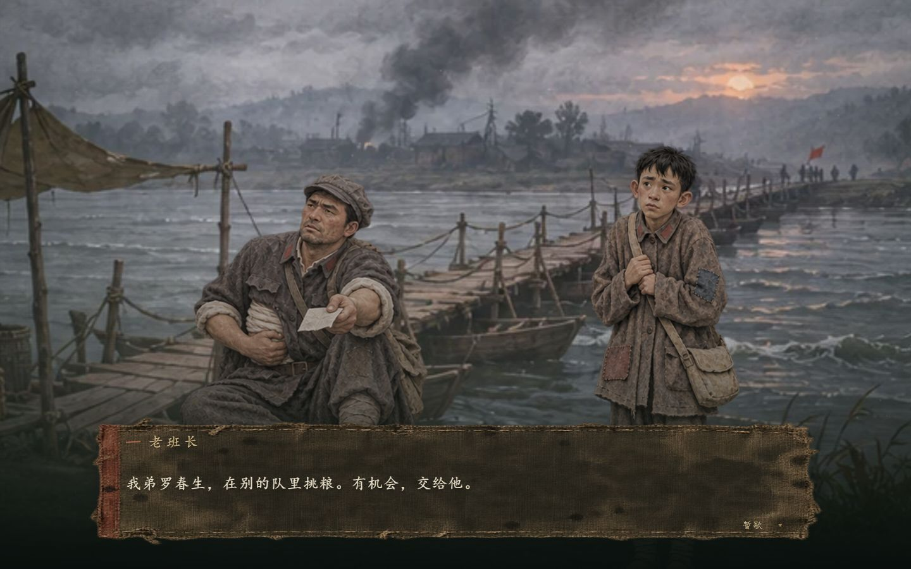

# 征途有光：把信送到的人

以虚构普通红军战士“石头”为视角的长征短篇互动叙事网页。玩家带着母亲的草鞋、口信与班长未写完的家书，在物资、身体状况和托付之间作出选择。

**五章十五场 · 五次关键抉择 · 四种个人结局 · 七名人物、30张姿态素材 · 支持双击单文件游玩**

面向2026年“零杯”网页设计大赛壹组、主题三“长征万里，薪火千秋”制作。重大历史进程固定，选择改变个人经历、关系、代价与记忆。人物及对白为原创虚构。



## 先玩起来

前往 [Releases 下载页面](https://github.com/Ethan2007-you/zhengtu-youguang/releases/latest)，按需要选择：

| 下载内容 | 适合谁 | 打开方式 |
| --- | --- | --- |
| 征途有光-双击即玩版.zip | 直接游玩、演示、转发 | 完整解压，用Edge或Chrome打开里面的index.html |
| 征途有光-完整开发包.zip | 修改剧情、美术、界面和功能 | 含源码、素材源稿、构建成品与说明 |

双击版把脚本、样式、背景、人物和剧情都内嵌在一个HTML中，约6.8MB；不需要Node.js、CMD或运行服务，可以把index.html单独复制到其他文件夹或U盘。历史资料外链需联网查看。

**GitHub文件页面用来查看源码，不会直接运行HTML游戏。** 请下载Release或下载仓库ZIP、完整解压后，在本机打开双击即玩/index.html。

自动检查工具禁止file://预览，本项目没有更改浏览器安全设置。单文件的资源内嵌、画面、选择与刷新恢复已通过提供同一HTML的本机HTTP预览检查；file协议下的直接打开与存储行为尚未覆盖各浏览器实测，详见 [验证记录](VALIDATION.md)。

## 三个index.html有什么区别

| 路径 | 用途 | 是否需要服务 |
| --- | --- | --- |
| index.html | Vite源码开发入口，引用src/main.tsx | 开发时运行npm run dev |
| dist/index.html | 普通静态网站成品入口 | 使用静态服务或网站托管 |
| 双击即玩/index.html | 所有运行资源已内嵌的单文件成品 | 按双击版方式打开 |

普通服务版保留了“打开征途有光.cmd”。安装Node.js后，双击它并访问终端显示的http://127.0.0.1:4179/；也可运行node server.mjs。服务只监听本机，关闭终端或按Ctrl+C停止。

## 已完成的体验

- 五章：出发、湘江、遵义、雪山草地、会师；每章三场，每场约200—300字。
- 五个关键选择和十个轻量行动，共31个选项；分支汇合后保留状态、物品与对白变化。
- 四个内部状态：信念、战友情、纪律／民心、体力／伤痛。界面主要显示具体处境和身体状况，不用道德等级评定人物。
- 草鞋、家书、半截皮带、盐包与号嘴有持续用途及延迟回收。例如保留的盐会在第五章登记入粥，实际恢复体力。
- 自动存档、一个手动存档槽、对白记录、历史回望、结局收藏、键盘操作和阅读速度设置。
- 满屏场景与旧布对白；核心四人各六组绘制姿态和表情，母亲、央金阿妈、刘婶各两组。
- 按具体情节表现递鞋、系鞋、核对去向、托信、包扎、举号、咳嗽、护碗与悲痛。每个人独立换姿态，角色入退场与物件时序受剧情约束。
- 标准、低特效、减少动态三档；关闭动态过渡后保留全部剧情与绘制姿态。

<details>
<summary>故事结构与个人结局（含剧透）</summary>

主角石头十六岁，胆小、倔强、想家；班长罗守田、卫生员陈杏与小号手冬生构成主要同行关系。央金阿妈与刘婶有自己的家庭、粮食限度与决定权。

主线采用章节内选择、节点汇合、状态持续的结构。五次关键抉择分别围绕职责、承诺方式、家书隐私、筹粮与最终交接展开。班长和冬生的牺牲是固定情节，不由一次分食“判死”。

| 结局 | 个人经历 |
| --- | --- |
| A 到灯下去 | 到达陕北，信交到收件人手里，代价随经历改变 |
| B 替你走完 | 石头牺牲，信、草鞋与记忆由战友接力 |
| C 迟到的平安 | 失散或寻人延误后归队，信迟到但送达 |
| D 借来的屋檐 | 经登记暂留群众家养伤，伤稳后追队 |

最终坚持亲送时，低体力条件会提前明示。托付、养伤、晚到与负伤不被写作道德失败。完整逐场钩子、正文、选项、即时反馈和延迟回收见 [五章互动剧情方案](石头-五章互动剧情方案.md)。

</details>

## 配乐与音效

点击「开始这段路」或「继续旅程」后才会播放声音。游玩时打开「暂歇 → 阅读、画面与声音」，可以分别调整配乐、环境与动作音效，或关闭全部声音。设置保存在当前浏览器。

离家时的拨弦主题在湘江转成低音，遵义用疏缓的簧管音色接住对白，雪山和草地分别使用风声与雨声，陕北重新接回开场旋律。托信和冬生的结尾会压低声场，陕北写到远处号响时才有一声远号。脚步、草绳、纸张、布料、铜扣、木板和碗声随对白与选择触发。

旋律、环境声和短音效由浏览器本地合成，随单文件版一起工作。音频编排见 [src/audioScore.ts](src/audioScore.ts)，合成与播放见 [src/soundscape.ts](src/soundscape.ts)。

## 本地开发

需要Node.js 22或更新版本与npm；本机验证环境为Node.js v24.18.0。普通开发、构建与测试不需要Python。

```sh
git clone https://github.com/Ethan2007-you/zhengtu-youguang.git
cd zhengtu-youguang
npm ci
npm run dev
```

按终端提供的地址访问。仓库如为私有，请使用有访问权限的GitHub账号克隆或下载。

| 命令 | 作用 |
| --- | --- |
| npm test | 剧情完整路径、存档与逐句人物演出检查 |
| npm run build | TypeScript检查并生成dist/ |
| npm run build:offline | 构建网页，再生成双击即玩/index.html |
| npm run preview | 预览普通静态构建 |
| npx tsx scripts/export_story.ts | 从当前剧情数据导出完整剧情方案 |

仓库包含dist/和双击即玩/的成品快照，便于下载后直接使用；修改源码后需要重新构建它们。构建单文件版时，也会生成仓库旁的“征途有光-双击即玩版”文件夹。它是便携成品，不作为开发入口。

## 从哪里修改

```text
src/
  story-data.json     章节、台词、选项、即时反馈与回收信息
  story.ts           状态、选择结算、历史回望与结局
  storage.ts         存档与重放校验
  performance.ts     每句台词与反馈的人物姿态、站位和动作
  CastStage.tsx      换图、入退场与动作层
  Scene.tsx          场景、镜头与天气
  PlayView.tsx        游戏内对白、选择、结局界面
  assetUrl.ts        服务版与单文件版的资源解析
  main.tsx           开始、设置、存读档和资料面板
public/assets/       运行素材
art/                 美术源稿、历史版本与生成提示词
scripts/             单文件打包、素材整理、剧本导出和本地打包
双击即玩/             单文件成品
dist/                普通静态网站成品
tests/               剧情和演出检查
docs/                截图、开发指南与发布说明
```

编辑和协作流程见 [开发指南](CONTRIBUTING.md)。scripts/rewrite_story.py是初次编写剧本时的生成脚本，运行会覆盖story-data.json；日常修改请直接编辑JSON，再导出方案。

## 操作与存档

点击场景或对白：先补全当前句，再点击推进；读完当前场景后展开选择。空格／Enter推进，L看记录，Esc暂歇。存档、设置与史料入口收在“暂歇”。

进度保存在当前浏览器的localStorage，不跨设备同步。双击文件版和localhost版属于不同访问位置，存档分开；移动或重命名HTML后，浏览器也可能使用另一个存档位置。清理浏览器数据会清除进度。新五章剧情使用独立命名空间，不混用早期三章存档。

## 历史与创作

石头等人物、对白、家书与具体小队任务均为虚构，不是历史引语或真人传记。普通战士不会决定全军战略；选择不改写重大历史事件。

时序区分：1934年出发与湘江，1935年1月遵义，6月夹金山、8月草地，10月到达陕北；1936年10月三大主力会师通过共同尾声说明。章节间省略部分真实行程，SVG图是章节时间顺序示意，不是精确地理地图。虚构班长的皮带与周广才真实文物明确区分。

资料来源：

- [遵义会议和红军长征的胜利](https://www.miit.gov.cn/ztzl/rdzt/dsxxjyzl/xxzl/art/2021/art_a43d76bc5e694806889c07fc36ec6adc.html)：工信部转载共产党员网，核对主要行程与事件时序。
- [红四方面军战士周广才在长征途中吃剩的皮带](https://www.chnmuseum.cn/zp/zpml/gmww/202105/t20210531_250098.shtml)：中国国家博物馆，用于区分真实文物与本作虚构物件。
- [长征精神](https://www.ndrc.gov.cn/fggz/fgjh/djzc/202104/t20210429_1278648_ext.html)：国家发展改革委，核对主题内涵。

史料查阅记录日期为2026年11月3日。游戏每章有可选阅读的“历史回望”。插画属于AI情境复原，具体伤员照护与缺粮描写不作为医疗或野外生存指引。

## 技术与素材

| 技术／依赖 | 用途 |
| --- | --- |
| React、React DOM 19 | 前端界面与交互状态 |
| TypeScript 5、Vite 6 | 类型检查、开发和静态构建 |
| GSAP 3 | 剧情镜头、入退场与动作过渡 |
| 原生CSS、Canvas 2D、SVG | 构图、天气、物件和章节示意 |
| tsx | 开发期测试与剧本导出 |
| Pillow（可选） | 美术源图的裁取、缩放与WebP编码，不参与网页运行 |

没有预设样式UI库、Three.js或外部游戏引擎；游戏运行资源不依赖CDN。美术源稿与原始图像生成提示词见 [ASSETS.md](ASSETS.md) 和 [人物提示词记录](art/cast-v3/PROMPTS.md)。人物使用绘制姿态切换与克制过渡，没有完整骨骼动作或配音。标题与正文优先使用系统字体，没有打包字体文件。

## 验证与当前限制

检查记录见 [VALIDATION.md](VALIDATION.md)：49,152条完整选择组合、四结局可达、120个代表性存档检查点、149个逐句／反馈演出检查；这些组合不代表同等数量的独立剧本。桌面和手机尺寸在内置浏览器中目视检查过。

尚未进行真实手机、指定Chrome129、慢网故障与长时间帧率专项测试，不声称稳定60fps。背景每景约683×384，宽屏有柔化；目前没有逐帧肢体动作、逐句配音或实录号声。首次游玩时长尚未通过用户计时研究验证。

## 团队与许可

TEAM.md为参赛信息模板，真实队伍信息待填写。开发包与最终匿名参赛包用途不同，本仓库不代表已经完成比赛提交。

项目尚未设置开源许可证。第三方依赖遵循各自许可证；源码、剧情与生成素材的来源和使用范围应分别确认。仓库的公开或私有可见性不替代许可证说明。
